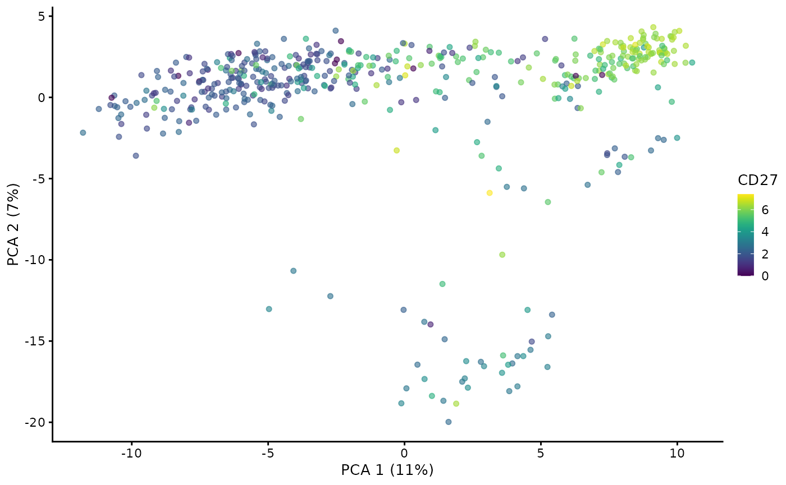

# CITE-seq data with CiteFuse and MuData

## Introduction

CITE-seq data provide RNA and surface protein counts for the same cells.
This tutorial shows how MuData can be integrated into with Bioconductor
workflows to analyse CITE-seq data.

## Installation

The most recent dev build can be installed from GitHub:

``` r

library(remotes)
remotes::install_github("ilia-kats/MuData")
```

Stable version of `MuData` will be available in future bioconductor
versions.

## Loading libraries

``` r

library(MuData)
library(SingleCellExperiment)
library(MultiAssayExperiment)
library(CiteFuse)
library(scater)

library(rhdf5)
```

## Loading data

We will use CITE-seq data available within [`CiteFuse` Bioconductor
package](http://www.bioconductor.org/packages/release/bioc/html/CiteFuse.md).

``` r

data("CITEseq_example", package = "CiteFuse")
lapply(CITEseq_example, dim)
#> $RNA
#> [1] 19521   500
#> 
#> $ADT
#> [1]  49 500
#> 
#> $HTO
#> [1]   4 500
```

This dataset contains three matrices — one with `RNA` counts, one with
antibody-derived tags (`ADT`) counts and one with hashtag
oligonucleotide (`HTO`) counts.

## Processing count matrices

While CITE-seq analysis workflows such as
[CiteFuse](http://www.bioconductor.org/packages/release/bioc/vignettes/CiteFuse/inst/doc/CiteFuse.md)
should be consulted for more details, below we exemplify simple data
transformations in order to demonstrate how their output can be saved to
an H5MU file later on.

Following the CiteFuse tutorial, we start with creating a
`SingleCellExperiment` object with the three matrices:

``` r

sce_citeseq <- preprocessing(CITEseq_example)
sce_citeseq
#> class: SingleCellExperiment 
#> dim: 19521 500 
#> metadata(0):
#> assays(1): counts
#> rownames(19521): hg19_AL627309.1 hg19_AL669831.5 ... hg19_MT-ND6
#>   hg19_MT-CYB
#> rowData names(0):
#> colnames(500): AAGCCGCGTTGTCTTT GATCGCGGTTATCGGT ... TTGGCAACACTAGTAC
#>   GCTGCGAGTTGTGGCC
#> colData names(0):
#> reducedDimNames(0):
#> mainExpName: NULL
#> altExpNames(2): ADT HTO
```

We will add a new assay with normalised RNA counts:

``` r

sce_citeseq <- scater::logNormCounts(sce_citeseq)
#> Warning in .library_size_factors(assay(x, assay.type), ...): 'librarySizeFactors' is deprecated.
#> Use 'scrapper::centerSizeFactors' instead.
#> See help("Deprecated")
#> Warning in .local(x, ...): 'normalizeCounts' is deprecated.
#> Use 'scrapper::normalizeCounts' instead.
#> See help("Deprecated")
sce_citeseq  # new assay: logcounts
#> class: SingleCellExperiment 
#> dim: 19521 500 
#> metadata(0):
#> assays(2): counts logcounts
#> rownames(19521): hg19_AL627309.1 hg19_AL669831.5 ... hg19_MT-ND6
#>   hg19_MT-CYB
#> rowData names(0):
#> colnames(500): AAGCCGCGTTGTCTTT GATCGCGGTTATCGGT ... TTGGCAACACTAGTAC
#>   GCTGCGAGTTGTGGCC
#> colData names(1): sizeFactor
#> reducedDimNames(0):
#> mainExpName: NULL
#> altExpNames(2): ADT HTO
```

To the ADT modality, we will add an assay with normalised counts:

``` r

sce_citeseq <- CiteFuse::normaliseExprs(
  sce_citeseq, altExp_name = "ADT", transform = "log"
)
altExp(sce_citeseq, "ADT")  # new assay: logcounts
#> class: SummarizedExperiment 
#> dim: 49 500 
#> metadata(0):
#> assays(2): counts logcounts
#> rownames(49): B220 (CD45R) B7-H1 (PD-L1) ... TCRb TCRg
#> rowData names(0):
#> colnames(500): AAGCCGCGTTGTCTTT GATCGCGGTTATCGGT ... TTGGCAACACTAGTAC
#>   GCTGCGAGTTGTGGCC
#> colData names(0):
```

We will also generate reduced dimensions:

``` r

sce_citeseq <- scater::runPCA(
  sce_citeseq, exprs_values = "logcounts", ncomponents = 20
)
```

``` r

scater::plotReducedDim(sce_citeseq, dimred = "PCA", 
                       by_exprs_values = "logcounts", colour_by = "CD27")
```



## Making a MultiAssayExperiment object

An appropriate structure for multimodal datasets is
[`MultiAssayExperiment`](https://bioconductor.org/packages/MultiAssayExperiment/).

We will make a respective MultiAssayExperiment object from
`sce_citeseq`:

``` r

experiments <- list(
  ADT = altExp(sce_citeseq, "ADT"),
  HTO = altExp(sce_citeseq, "HTO")
)

# Drop other modalities from sce_citeseq
altExp(sce_citeseq) <- NULL
experiments[["RNA"]] <- sce_citeseq

mae <- MultiAssayExperiment(experiments)
```

## Writing to H5MU

We can write the contents of the MultiAssayExperiment object into an
H5MU file:

``` r

writeH5MU(mae, "citefuse_example.h5mu")
```

We can check that all the modalities were written to the file:

``` r

h5 <- rhdf5::H5Fopen("citefuse_example.h5mu")
h5ls(H5Gopen(h5, "mod"), recursive = FALSE)
#>   group name     otype dclass dim
#> 0     /  ADT H5I_GROUP           
#> 1     /  HTO H5I_GROUP           
#> 2     /  RNA H5I_GROUP
```

… both assays for ADT — raw counts are stored in `X` and normalised
counts are in the corresponding layer:

``` r

h5ls(H5Gopen(h5, "mod/ADT"), FALSE)
#>   group   name     otype dclass dim
#> 0     /      X H5I_GROUP           
#> 1     / layers H5I_GROUP           
#> 2     /    obs H5I_GROUP           
#> 3     /    var H5I_GROUP
h5ls(H5Gopen(h5, "mod/ADT/layers"), FALSE)
#>   group      name       otype dclass      dim
#> 0     / logcounts H5I_DATASET  FLOAT 49 x 500
```

… as well as reduced dimensions (PCA):

``` r

h5ls(H5Gopen(h5, "mod/RNA/obsm"), FALSE)
#>   group name       otype dclass      dim
#> 0     /  PCA H5I_DATASET  FLOAT 20 x 500
# There is an alternative way to access groups:
# h5&'mod'&'RNA'&'obsm'
rhdf5::H5close()
```

## References

- [Muon: multimodal omics analysis
  framework](https://www.biorxiv.org/content/10.1101/2021.06.01.445670)
  preprint

- [mudata](https://mudata.readthedocs.io/) (Python) documentation

- muon [documentation](https://muon.readthedocs.io/) and [web
  page](https://gtca.github.io/muon/)

- Kim HJ, Lin Y, Geddes TA, Yang P, Yang JYH (2020). “CiteFuse enables
  multi-modal analysis of CITE-seq data.” Bioinformatics, 36(14),
  4137–4143. <https://doi.org/10.1093/bioinformatics/btaa282>.

- Ramos M, Schiffer L, Re A, Azhar R, Basunia A, Cabrera CR, Chan T,
  Chapman P, Davis S, Gomez-Cabrero D, Culhane AC, Haibe-Kains B, Hansen
  K, Kodali H, Louis MS, Mer AS, Reister M, Morgan M, Carey V, Waldron L
  (2017). “Software For The Integration Of Multi-Omics Experiments In
  Bioconductor.” Cancer Research, 77(21); e39-42.

## Session Info

``` r

sessionInfo()
#> R Under development (unstable) (2026-10-25 r90763)
#> Platform: x86_64-pc-linux-gnu
#> Running under: Ubuntu 26.04.1 LTS
#> 
#> Matrix products: default
#> BLAS:   /usr/lib/x86_64-linux-gnu/openblas-pthread/libblas.so.3 
#> LAPACK: /usr/lib/x86_64-linux-gnu/openblas-pthread/libopenblasp-r0.3.32.so;  LAPACK version 3.12.0
#> 
#> locale:
#>  [1] LC_CTYPE=C.UTF-8       LC_NUMERIC=C           LC_TIME=C.UTF-8       
#>  [4] LC_COLLATE=C.UTF-8     LC_MONETARY=C.UTF-8    LC_MESSAGES=C.UTF-8   
#>  [7] LC_PAPER=C.UTF-8       LC_NAME=C              LC_ADDRESS=C          
#> [10] LC_TELEPHONE=C         LC_MEASUREMENT=C.UTF-8 LC_IDENTIFICATION=C   
#> 
#> time zone: UTC
#> tzcode source: system (glibc)
#> 
#> attached base packages:
#> [1] stats4    stats     graphics  grDevices utils     datasets  methods  
#> [8] base     
#> 
#> other attached packages:
#>  [1] scater_1.40.2               ggplot2_4.0.3              
#>  [3] scuttle_1.22.0              CiteFuse_1.24.0            
#>  [5] MultiAssayExperiment_1.38.0 SingleCellExperiment_1.34.0
#>  [7] SummarizedExperiment_1.42.0 Biobase_2.72.0             
#>  [9] GenomicRanges_1.64.0        Seqinfo_1.2.0              
#> [11] IRanges_2.46.0              MatrixGenerics_1.24.0      
#> [13] matrixStats_1.5.0           MuData_1.11.1              
#> [15] rhdf5_2.56.1                S4Vectors_0.50.3           
#> [17] BiocGenerics_0.58.1         generics_0.1.4             
#> [19] Matrix_1.7-6                BiocStyle_2.40.0           
#> 
#> loaded via a namespace (and not attached):
#>   [1] gridExtra_2.3.1      rlang_1.3.0          magrittr_2.0.5      
#>   [4] otel_0.2.0           ggridges_0.5.7       compiler_4.7.0      
#>   [7] systemfonts_1.3.2    vctrs_0.7.3          reshape2_1.4.5      
#>  [10] stringr_1.6.0        pkgconfig_2.0.3      fastmap_1.2.0       
#>  [13] XVector_0.52.0       labeling_0.4.3       ggraph_2.2.2        
#>  [16] rmarkdown_2.32       ggbeeswarm_0.7.3     ragg_1.5.2          
#>  [19] purrr_1.2.2          bluster_1.22.0       xfun_0.62           
#>  [22] beachmat_2.28.0      randomForest_4.7-1.2 cachem_1.1.0        
#>  [25] jsonlite_2.0.0       rhdf5filters_1.24.1  DelayedArray_0.38.2 
#>  [28] BiocParallel_1.46.0  Rhdf5lib_2.0.0       tweenr_2.0.3        
#>  [31] cluster_2.1.8.3      irlba_2.4.1          parallel_4.7.0      
#>  [34] R6_2.6.1             stringi_1.8.9        bslib_0.12.0        
#>  [37] RColorBrewer_1.1-3   limma_3.68.5         compositions_2.0-9  
#>  [40] jquerylib_0.1.4      Rcpp_1.1.2           bookdown_0.48       
#>  [43] knitr_1.52           mixtools_2.0.0.1     splines_4.7.0       
#>  [46] igraph_2.3.4         tidyselect_1.2.1     abind_1.4-8         
#>  [49] yaml_2.3.12          viridis_0.6.5        codetools_0.2-20    
#>  [52] plyr_1.8.9           lattice_0.23-1       tibble_3.3.1        
#>  [55] withr_3.0.3          S7_0.2.2             evaluate_1.0.5      
#>  [58] Rtsne_0.17           desc_1.4.3           survival_3.8-12     
#>  [61] bayesm_3.1-7         polyclip_1.10-7      kernlab_0.9-33      
#>  [64] pillar_1.11.1        BiocManager_1.30.27  tensorA_0.36.2.1    
#>  [67] plotly_4.12.1        dbscan_1.2.7         scales_1.4.0        
#>  [70] glue_1.8.1           metapod_1.20.0       pheatmap_1.0.13     
#>  [73] tools_4.7.0          BiocNeighbors_2.6.0  robustbase_0.99-7   
#>  [76] data.table_1.18.6.1  ScaledMatrix_1.20.0  locfit_1.5-9.12     
#>  [79] scran_1.40.0         fs_2.1.0             graphlayouts_1.2.5  
#>  [82] tidygraph_1.3.1      cowplot_1.2.0        grid_4.7.0          
#>  [85] tidyr_1.3.2          edgeR_4.10.7         nlme_3.1-171        
#>  [88] beeswarm_0.4.0       BiocSingular_1.28.1  ggforce_0.5.0       
#>  [91] vipor_0.4.7          rsvd_1.0.6           cli_3.6.6           
#>  [94] textshaping_1.0.5    segmented_2.2-2      S4Arrays_1.12.1     
#>  [97] viridisLite_0.4.3    dplyr_1.2.1          uwot_0.2.5          
#> [100] gtable_0.3.6         DEoptimR_1.2-2       sass_0.4.10         
#> [103] digest_0.6.39        dqrng_0.4.1          SparseArray_1.12.3  
#> [106] ggrepel_0.9.8        htmlwidgets_1.6.4    farver_2.1.2        
#> [109] memoise_2.0.1        htmltools_0.5.9      pkgdown_2.2.1       
#> [112] lifecycle_1.0.5      httr_1.4.9           statmod_1.5.2       
#> [115] MASS_7.3-66
```
