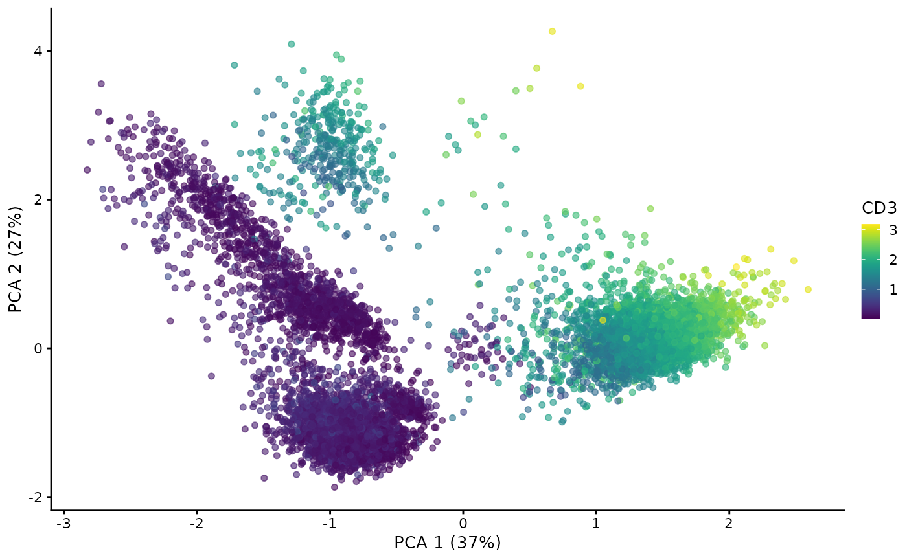
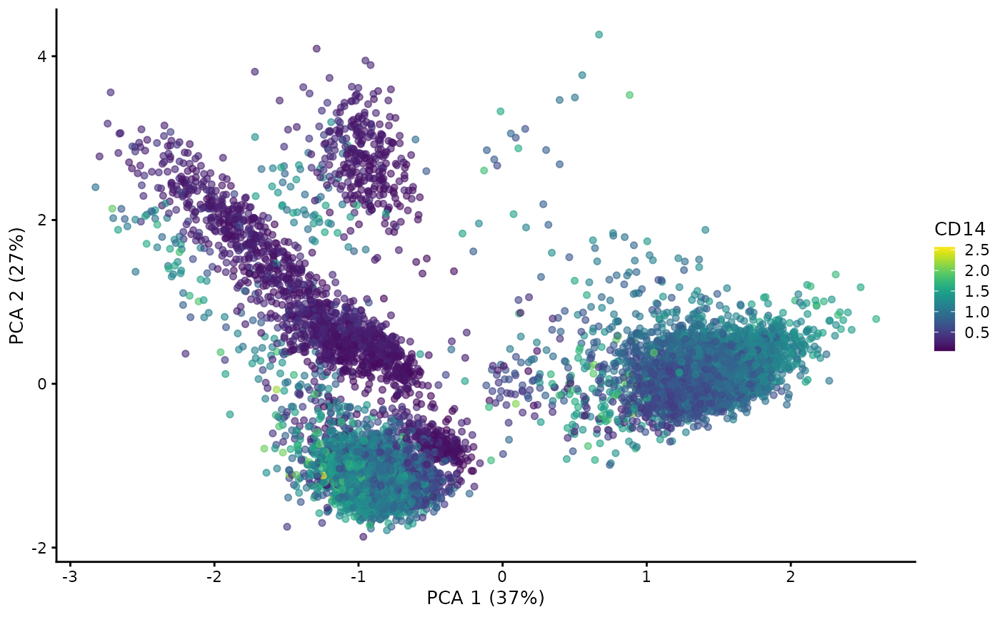

# CITE-seq data with MultiAssayExperiment and MuData

## Introduction

CITE-seq data provide RNA and surface protein counts for the same cells.
This tutorial shows how MuData can be integrated into with Bioconductor
workflows to analyse CITE-seq data.

## Installation

The most recent dev build can be installed from GitHub:

``` r

library(remotes)
remotes::install_github("ilia-kats/MuData")
```

Stable version of `MuData` will be available in future bioconductor
versions.

## Loading libraries

``` r

library(MuData)
library(SingleCellExperiment)
library(MultiAssayExperiment)
library(SingleCellMultiModal)
library(scater)

library(rhdf5)
```

## Loading data

We will use CITE-seq data accessible with the [`SingleCellMultiModal`
Bioconductor
package](https://bioconductor.org/packages/release/data/experiment/vignettes/SingleCellMultiModal/inst/doc/CITEseq.html),
which was originally described in [Stoeckius et al.,
2017](https://www.nature.com/articles/nmeth.4380).

``` r

mae <- CITEseq(
    DataType="cord_blood", modes="*", dry.run=FALSE, version="1.0.0"
)
#> Dataset: cord_blood
#> Working on: scADT_Counts
#> Working on: scRNAseq_Counts
#> Working on: coldata_scRNAseq
#> Working on: scADT_clrCounts
#> see ?SingleCellMultiModal and browseVignettes('SingleCellMultiModal') for documentation
#> downloading 1 resources
#> retrieving 1 resource
#> loading from cache
#> see ?SingleCellMultiModal and browseVignettes('SingleCellMultiModal') for documentation
#> downloading 1 resources
#> retrieving 1 resource
#> loading from cache
#> see ?SingleCellMultiModal and browseVignettes('SingleCellMultiModal') for documentation
#> downloading 1 resources
#> retrieving 1 resource
#> loading from cache
#> see ?SingleCellMultiModal and browseVignettes('SingleCellMultiModal') for documentation
#> downloading 1 resources
#> retrieving 1 resource
#> loading from cache
#> Warning: 'ExperimentList' contains 'data.frame' or 'DataFrame',
#>   potential for errors with mixed data types
#> harmonizing input:
#>   removing 2277 sampleMap rows with 'primary' not in colData

mae
#> A MultiAssayExperiment object of 3 listed
#>  experiments with user-defined names and respective classes.
#>  Containing an ExperimentList class object of length 3:
#>  [1] scADT_clr: matrix with 13 rows and 7858 columns
#>  [2] scADT: matrix with 13 rows and 7858 columns
#>  [3] scRNAseq: matrix with 36280 rows and 7858 columns
#> Functionality:
#>  experiments() - obtain the ExperimentList instance
#>  colData() - the primary/phenotype DataFrame
#>  sampleMap() - the sample coordination DataFrame
#>  `$`, `[`, `[[` - extract colData columns, subset, or experiment
#>  *Format() - convert into a long or wide DataFrame
#>  assays() - convert ExperimentList to a SimpleList of matrices
#>  exportClass() - save data to flat files
```

We see two modalities in the object — `scRNAseq` and `scADT`, the latter
providing counts for antibody-derived tags. Notably, each experiment is
a matrix.

## Processing ADT data

While CITE-seq analysis workflows such as
[CiteFuse](http://www.bioconductor.org/packages/release/bioc/html/CiteFuse.md)
should be consulted for more details, below we exemplify simple data
transformation in order to demonstrate how their output can be saved to
an H5MU file later on.

For ADT counts, we will apply CLR transformation following [Hao et al.,
2020](https://doi.org/10.1016/j.cell.2021.04.048):

``` r

# Define CLR transformation as in the Seurat workflow
clr <- function(data) t(
  apply(data, 1, function(x) log1p(
    x / (exp(sum(log1p(x[x > 0]), na.rm = TRUE) / length(x)))
  ))
)
```

We will make the ADT modality a `SingleCellExperiment` object and add an
assay with CLR-transformed counts:

``` r

adt_counts <- mae[["scADT"]]

mae[["scADT"]] <- SingleCellExperiment(adt_counts)
assay(mae[["scADT"]], "clr") <- clr(adt_counts)
```

We will also generate reduced dimensions taking advantage of the
functionality in the [`scater`
package](https://bioconductor.org/packages/release/bioc/vignettes/scater/inst/doc/overview.html):

``` r

mae[["scADT"]] <- runPCA(
  mae[["scADT"]], exprs_values = "clr", ncomponents = 20
)
#> Warning in check_numbers(k = k, nu = nu, nv = nv, limit = min(dim(x)) - : more
#> singular values/vectors requested than available
#> Warning in (function (A, nv = 5, nu = nv, maxit = 1000, work = nv + 16, :
#> You're computing too large a percentage of total singular values, use a
#> standard svd instead.
#> Warning in (function (A, nv = 5, nu = nv, maxit = 1000, work = nv + 16, : did
#> not converge--results might be invalid!; try increasing maxit or work
```

``` r

plotReducedDim(mae[["scADT"]], dimred = "PCA",
               by_exprs_values = "clr", colour_by = "CD3")
```



``` r

plotReducedDim(mae[["scADT"]], dimred = "PCA",
               by_exprs_values = "clr", colour_by = "CD14")
```



## Writing H5MU files

We can write the contents of the MultiAssayExperiment object into an
H5MU file:

``` r

writeH5MU(mae, "cord_blood_citeseq.h5mu")
```

We can check that both modalities were written to the file, whether it
was a `matrix` for RNA or `SingleCellExperiment` for ADT:

``` r

h5 <- rhdf5::H5Fopen("cord_blood_citeseq.h5mu")
h5ls(H5Gopen(h5, "mod"), recursive = FALSE)
#>   group      name     otype dclass dim
#> 0     /     scADT H5I_GROUP           
#> 1     / scADT_clr H5I_GROUP           
#> 2     /  scRNAseq H5I_GROUP
```

… both assays for ADT — raw counts are stored in `X` and CLR-transformed
counts are in the corresponding layer:

``` r

h5ls(H5Gopen(h5, "mod/scADT"), recursive = FALSE)
#>   group   name       otype  dclass       dim
#> 0     /      X H5I_DATASET INTEGER 13 x 7858
#> 1     / layers   H5I_GROUP                  
#> 2     /    obs   H5I_GROUP                  
#> 3     /   obsm   H5I_GROUP                  
#> 4     /    var   H5I_GROUP
h5ls(H5Gopen(h5, "mod/scADT/layers"), recursive = FALSE)
#>   group name       otype dclass       dim
#> 0     /  clr H5I_DATASET  FLOAT 13 x 7858
```

… as well as reduced dimensions (PCA):

``` r

h5ls(H5Gopen(h5, "mod/scADT/obsm"), recursive = FALSE)
#>   group name       otype dclass       dim
#> 0     /  PCA H5I_DATASET  FLOAT 12 x 7858
# There is an alternative way to access groups:
# h5&'mod'&'scADT'&'obsm'
rhdf5::H5close()
```

## References

- [Muon: multimodal omics analysis
  framework](https://www.biorxiv.org/content/10.1101/2021.06.01.445670)
  preprint

- [mudata](https://mudata.readthedocs.io/) (Python) documentation

- muon [documentation](https://muon.readthedocs.io/) and [web
  page](https://gtca.github.io/muon/)

- Stoeckius, M., Hafemeister, C., Stephenson, W., Houck-Loomis, B.,
  Chattopadhyay, P.K., Swerdlow, H., Satija, R. and Smibert, P., 2017.
  Simultaneous epitope and transcriptome measurement in single cells.
  *Nature methods*, 14(9), pp.865-868.

- Hao, Y., Hao, S., Andersen-Nissen, E., Mauck III, W.M., Zheng, S.,
  Butler, A., Lee, M.J., Wilk, A.J., Darby, C., Zager, M. and Hoffman,
  P., 2021. Integrated analysis of multimodal single-cell data. *Cell*.

## Session Info

``` r

sessionInfo()
#> R Under development (unstable) (2026-10-26 r90766)
#> Platform: x86_64-pc-linux-gnu
#> Running under: Ubuntu 26.04.1 LTS
#> 
#> Matrix products: default
#> BLAS:   /usr/lib/x86_64-linux-gnu/openblas-pthread/libblas.so.3 
#> LAPACK: /usr/lib/x86_64-linux-gnu/openblas-pthread/libopenblasp-r0.3.32.so;  LAPACK version 3.12.0
#> 
#> locale:
#>  [1] LC_CTYPE=C.UTF-8       LC_NUMERIC=C           LC_TIME=C.UTF-8       
#>  [4] LC_COLLATE=C.UTF-8     LC_MONETARY=C.UTF-8    LC_MESSAGES=C.UTF-8   
#>  [7] LC_PAPER=C.UTF-8       LC_NAME=C              LC_ADDRESS=C          
#> [10] LC_TELEPHONE=C         LC_MEASUREMENT=C.UTF-8 LC_IDENTIFICATION=C   
#> 
#> time zone: UTC
#> tzcode source: system (glibc)
#> 
#> attached base packages:
#> [1] stats4    stats     graphics  grDevices utils     datasets  methods  
#> [8] base     
#> 
#> other attached packages:
#>  [1] scater_1.40.2               ggplot2_4.0.3              
#>  [3] scuttle_1.22.0              SingleCellMultiModal_1.24.0
#>  [5] MultiAssayExperiment_1.38.0 SingleCellExperiment_1.34.0
#>  [7] SummarizedExperiment_1.42.0 Biobase_2.72.0             
#>  [9] GenomicRanges_1.64.0        Seqinfo_1.2.0              
#> [11] IRanges_2.46.0              MatrixGenerics_1.24.0      
#> [13] matrixStats_1.5.0           MuData_1.17.1              
#> [15] rhdf5_2.56.1                S4Vectors_0.50.3           
#> [17] BiocGenerics_0.58.1         generics_0.1.4             
#> [19] Matrix_1.7-6                BiocStyle_2.40.0           
#> 
#> loaded via a namespace (and not attached):
#>  [1] DBI_1.3.0                gridExtra_2.3.1          httr2_1.3.0             
#>  [4] rlang_1.3.0              magrittr_2.0.5           otel_0.2.0              
#>  [7] compiler_4.7.0           RSQLite_3.53.3           png_0.1-9               
#> [10] systemfonts_1.3.2        vctrs_0.7.3              pkgconfig_2.0.3         
#> [13] SpatialExperiment_1.22.0 crayon_1.5.3             fastmap_1.2.0           
#> [16] dbplyr_2.6.0             magick_2.9.1             XVector_0.52.0          
#> [19] labeling_0.4.3           rmarkdown_2.32           ggbeeswarm_0.7.3        
#> [22] ragg_1.5.2               purrr_1.2.2              bit_4.6.0               
#> [25] xfun_0.62                cachem_1.1.0             beachmat_2.28.0         
#> [28] jsonlite_2.0.0           blob_1.3.0               rhdf5filters_1.24.1     
#> [31] DelayedArray_0.38.2      Rhdf5lib_2.0.0           BiocParallel_1.46.0     
#> [34] irlba_2.4.1              parallel_4.7.0           R6_2.6.1                
#> [37] bslib_0.12.0             RColorBrewer_1.1-3       jquerylib_0.1.4         
#> [40] Rcpp_1.1.2               bookdown_0.48            knitr_1.52              
#> [43] BiocBaseUtils_1.14.2     tidyselect_1.2.1         viridis_0.6.5           
#> [46] abind_1.4-8              yaml_2.3.12              codetools_0.2-20        
#> [49] curl_8.1.0               lattice_0.23-1           tibble_3.3.1            
#> [52] withr_3.0.3              KEGGREST_1.52.2          S7_0.2.2                
#> [55] evaluate_1.0.5           desc_1.4.3               BiocFileCache_3.2.0     
#> [58] ExperimentHub_3.2.2      Biostrings_2.80.2        pillar_1.11.1           
#> [61] BiocManager_1.30.27      filelock_1.0.3           BiocVersion_3.23.1      
#> [64] scales_1.4.0             glue_1.8.1               tools_4.7.0             
#> [67] AnnotationHub_4.2.2      BiocNeighbors_2.6.0      ScaledMatrix_1.20.0     
#> [70] fs_2.1.0                 cowplot_1.2.0            grid_4.7.0              
#> [73] AnnotationDbi_1.74.0     beeswarm_0.4.0           BiocSingular_1.28.1     
#> [76] vipor_0.4.7              rsvd_1.0.6               cli_3.6.6               
#> [79] rappdirs_0.3.4           textshaping_1.0.5        viridisLite_0.4.3       
#> [82] S4Arrays_1.12.1          dplyr_1.2.1              gtable_0.3.6            
#> [85] sass_0.4.10              digest_0.6.39            ggrepel_0.9.8           
#> [88] SparseArray_1.12.3       rjson_0.2.23             htmlwidgets_1.6.4       
#> [91] farver_2.1.2             memoise_2.0.1            htmltools_0.5.9         
#> [94] pkgdown_2.2.1            lifecycle_1.0.5          httr_1.4.9              
#> [97] bit64_4.8.6
```
